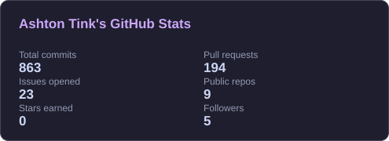
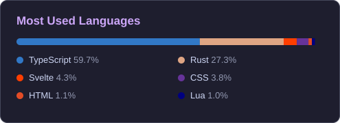

  
  
  
  

  
  
  

---

## 👋 About me

<table>
  <tr>
    <td width="58%" valign="top">
      
I'm a student from <strong>Western Australia</strong> who turns ideas into working software. I like building things from scratch and understanding every layer of them: game servers, launchers, tools, websites and games.

      
Lately that means a lot of <strong>Rust</strong> and a lot of <strong>local-first</strong> tools: your data stays on your machine, and the app keeps working when the internet doesn't.

      <blockquote><em>Breaks things → fixes them → blames Linux.</em></blockquote>
    </td>
    <td width="42%" valign="top">
      <table>
        <tr><td>🦀</td><td><strong>Rust</strong> servers, launchers, games</td></tr>
        <tr><td>🎮</td><td><strong>Game dev</strong> systems, tooling, pixel art</td></tr>
        <tr><td>🏗️</td><td><strong>Architecture</strong> maintainable &amp; tested</td></tr>
        <tr><td>🐧</td><td><strong>Linux &amp; self-hosting</strong> Hyprland, Docker, homelab</td></tr>
        <tr><td>📚</td><td><strong>Teaching</strong> Rust &amp; Java handbooks</td></tr>
      </table>
    </td>
  </tr>
</table>

---

## 🌱 Flagship: Moss

<table>
  <tr>
    <td valign="top">
      <h3><a href="https://github.com/T1nkiePlayz/Moss">Moss</a> · <em>Game servers that keep growing, quietly.</em></h3>
      
A fast, <strong>local-first controller for Minecraft Java servers</strong> on Linux and macOS: one small Rust binary with an embedded web panel, full mod support and compatibility checks, and servers that survive everything except you pulling the plug.

      <ul>
        <li>🔁 <strong>Servers outlive the controller</strong>: kill or upgrade Moss mid-game and the server, console and players are untouched</li>
        <li>🧩 <strong>Compatibility checks on real jars</strong> for Paper, Fabric, Quilt, Forge, NeoForge and Velocity, plus Modrinth &amp; CurseForge</li>
        <li>💾 <strong>Backups you can trust</strong>: checksummed, verifiable, with restore previews and S3-compatible remote destinations</li>
        <li>⬆️ <strong>Version upgrade assistant</strong> with per-mod verdicts, rollback and undo for every change</li>
        <li>⚡ A ~34&nbsp;KB (gzipped) Svelte UI, no Docker required, containers optional</li>
      </ul>
      

        
        
        
      

      

        
        
        
        
        
        
        
      

    </td>
  </tr>
</table>

---

## 🚀 More projects

<table>
  <tr>
    <td width="50%" valign="top">
      <h3>🍡 Mochi</h3>
      
<em>Your games, your way.</em>

      
A <strong>local-first desktop game launcher</strong> that sits above Steam, Heroic, Flatpak, Lutris and plain executables. Library, collections, backlog, save backups, launch options and mod management.

      
   

      
<a href="https://github.com/T1nkiePlayz/Mochi">📦 Source</a> &nbsp;·&nbsp; <a href="https://mochi.ashtontink.com">🌐 Website</a> &nbsp;·&nbsp; 🚧 early development

    </td>
    <td width="50%" valign="top">
      <h3>✨ DotFiles</h3>
      
<em>My Linux desktop &amp; workflow.</em>

      
Catppuccin-themed <strong>Hyprland (Lua + DMS)</strong>, Fish/Zsh, Kitty, Ghostty and a <strong>Neovim</strong> config on mini.nvim and Treesitter, plus Spicetify, Vencord, GTK and Qt theming.

      
  

      
<a href="https://github.com/T1nkiePlayz/DotFiles">📦 Source</a>

    </td>
  </tr>
  <tr>
    <td width="50%" valign="top">
      <h3>📚 Handbooks</h3>
      
<em>Free, visual guides for learning to code.</em>

      
<strong>Rust from Zero</strong>: 21 chapters, 88 annotated examples and a self-quiz, from installing Rust to unsafe FFI. Plus a <strong>Java &amp; Kotlin</strong> handbook.

      
  

      
<a href="https://rust.handbook.ashtontink.com">🦀 Rust</a> &nbsp;·&nbsp; <a href="http://java.handbook.ashtontink.com">☕ Java</a> &nbsp;·&nbsp; <a href="https://github.com/T1nkiePlayz/Rust-Handbook">📦 Source</a>

    </td>
    <td width="50%" valign="top">
      <h3>⚔️ Aetheria &amp; 🔨 Embermark</h3>
      
<em>My game projects.</em>

      
<strong>Aetheria</strong> is my long-term RPG, with systems, world and pixel art all made by me. <strong>Embermark Forgery</strong> is a smaller, tightly scoped game written in Rust.

      
  

      
🔒 private &nbsp;·&nbsp; 🛠️ in development

    </td>
  </tr>
  <tr>
    <td colspan="2" valign="top">
      <h3>🌐 Websites</h3>
      

        <a href="https://www.ashtontink.com"><strong>ashtontink.com</strong></a> (<a href="https://github.com/T1nkiePlayz/ashtontink.com">source</a>), my hand-written personal site &nbsp;·&nbsp;
        <a href="https://moss.ashtontink.com"><strong>Moss</strong></a> (<a href="https://github.com/T1nkiePlayz/Moss-Website">source</a>), Astro, zero client framework &nbsp;·&nbsp;
        <a href="https://mochi.ashtontink.com"><strong>Mochi</strong></a> (<a href="https://github.com/T1nkiePlayz/Mochi-Website">source</a>)
      

    </td>
  </tr>
</table>

---

## 🛠️ Tech stack

**Languages**

**Frameworks & libraries**

**Game dev & art**

**Tools & platforms**

> 🎯 **Currently levelling up:** Rust (async, systems, Tauri), C# and C++, software architecture, pixel art, and shipping larger projects end to end.

---

## 📊 GitHub stats

  
  

Generated daily by a <a href="./.github/workflows/stats.yml">GitHub Action</a> from public repositories.

---

## 🔭 What I'm working on

| Project | Focus | Status |
| :-- | :-- | :-- |
| 🌱 **Moss** | Minecraft server controller: mods, backups, upgrades, first signed release and desktop app | 🟠 Early development |
| 🍡 **Mochi** | Local-first launcher: library, launch targets, metadata, sync | 🟠 Early development |
| 🔨 **Embermark Forgery** | Small, scoped Rust game | 🟡 In progress |
| ⚔️ **Aetheria** | Long-term RPG: systems, world and pixel art | 🟡 In progress |
| 📚 **Handbooks** | Rust and Java/Kotlin learning guides | 🟢 Ongoing |
| 🐧 **Homelab** | Linux, Docker and self-hosting experiments | 🟢 Ongoing |

---

## 🎯 Interests

<table>
  <tr>
    <td width="33%" valign="top">
      <h4>💻 Building</h4>
      🦀 Rust 🎮 Game dev 🌐 Web dev 🎨 Pixel art
    </td>
    <td width="33%" valign="top">
      <h4>🐧 Tinkering</h4>
      🐧 Linux &amp; Hyprland 🖥️ Self-hosting 🐳 Docker &amp; homelab ⌨️ Neovim
    </td>
    <td width="33%" valign="top">
      <h4>🕹️ Off the clock</h4>
      ⛏️ Minecraft &amp; Hytale 👻 FNAF ⚽ Soccer 🎵 Spicetify-ing everything
    </td>
  </tr>
</table>

<strong>💬 Ask me about…</strong>

 
Minecraft server hosting, Rust, Linux (and why I still use it), Hyprland rice, Docker, game development, pixel art, or whatever I'm currently building.

---

## 🤝 Let's connect

I'm always happy to chat about game dev, Linux, Rust or tooling, or to hear feedback on my projects.

  
  
  

Thanks for stopping by! ⭐ Star a repo if something looks useful.

